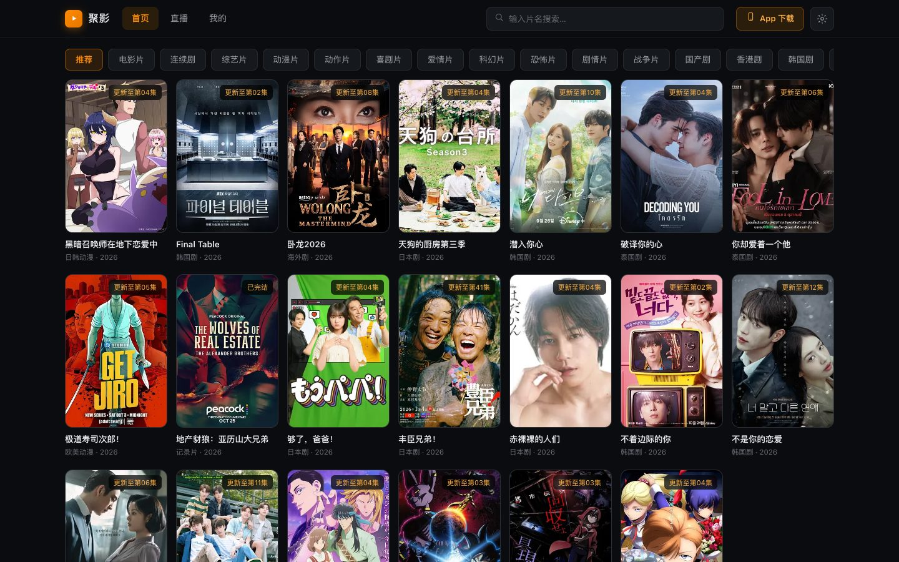
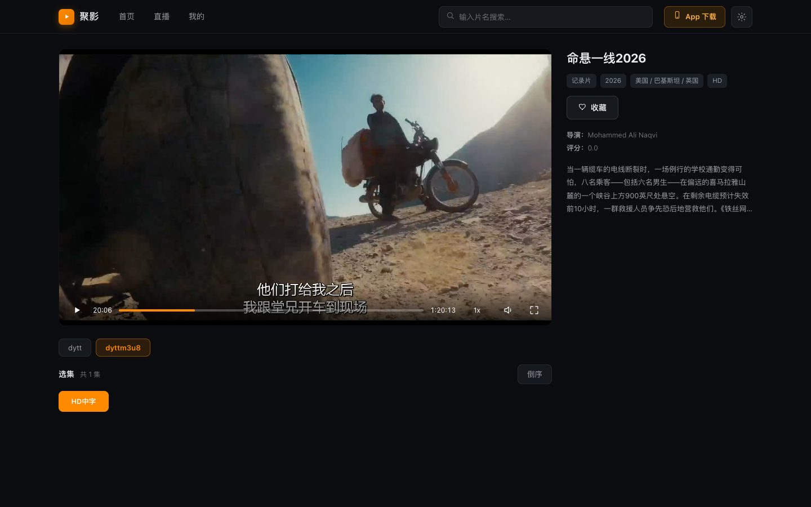
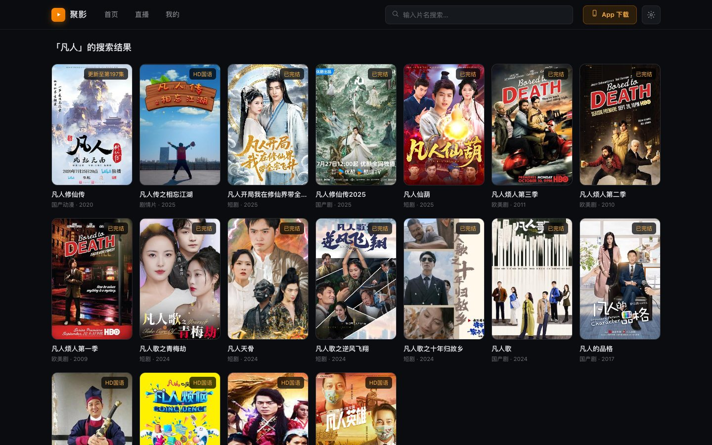
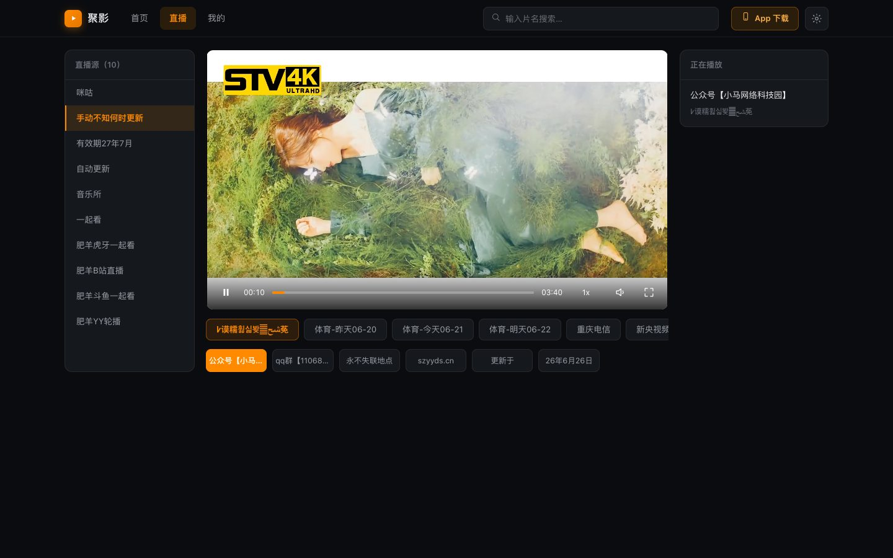
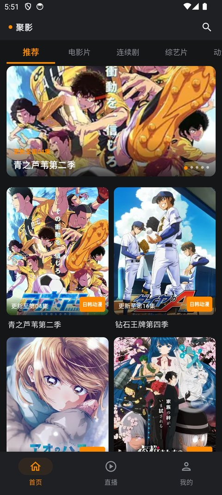
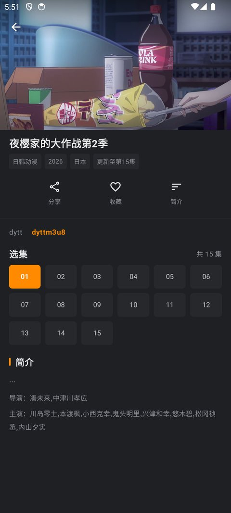
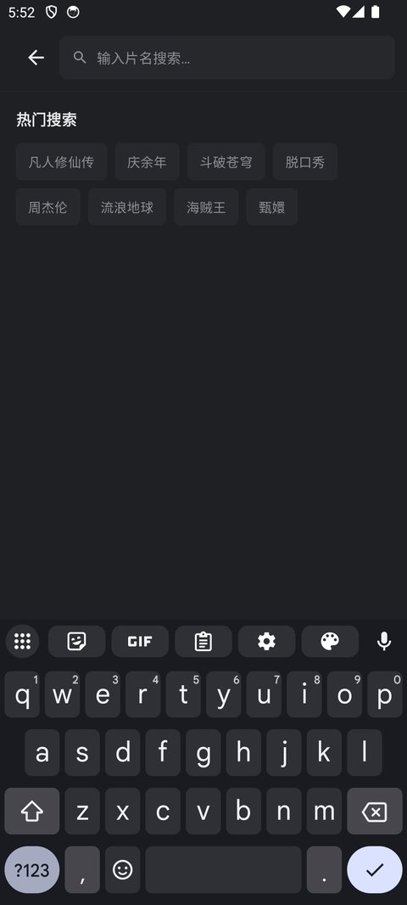
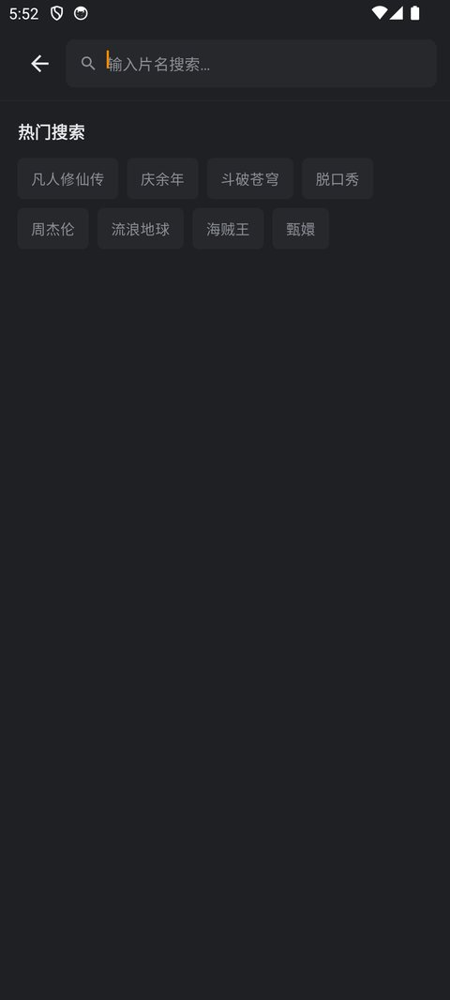

# 聚影 · TVBox（App + Web）

> **本项目 100% 由 AI（KIMI-K3）编写完成。**
> **无广告、无需注册登录，只有最纯粹的视频观看体验。**

参考 TVBox（影视仓）实现的影视聚合播放器，**同一份 TVBox 数据源，Android App 与纯客户端 Web 站双端通用**。给定接口（数据源）地址后，自动加载、解析配置，支持点播与直播。

    

## 🌐 Web 端（在线使用，免安装）

**地址：[csuhan.github.io/tvbox](https://csuhan.github.io/tvbox/)**

纯客户端视频站（Vue 3 + hls.js），**没有服务器端**：页面直接调用 TVBox 接口 API（浏览器跨域经公共/自建代理转发），数据与设置全部保存在本机 localStorage。

- 与 App 一致的体验：首页分类、实时搜索、多线路选集、直播分组、观看历史（进度记忆）、收藏
- 内置推荐接口，一键选用；支持添加自有接口、自定义 CORS 代理
- m3u8/mp4 直连播放（HLS 走 hls.js，播放页类地址 Web 端无法嗅探，请用 App）

| 首页 | 播放 | 搜索 | 直播 |
|---|---|---|---|
|  |  |  |  |

## 📱 App 端（Android）

前往 [**Releases**](https://github.com/csuhan/tvbox/releases) 下载 APK（约 2.5MB，Android 7.0+），安装后进入「我的 → 设置与数据源」配置接口即可。

- **纯粹体验**：无广告、无账号体系、无埋点统计
- **极致小巧**：R8 全量压缩，仅约 2.5MB
- **网页嗅探**：非直连播放页自动在后台 WebView 中嗅探真实视频地址（Web 端受浏览器限制无此能力）
- 明暗双主题跟随系统

| 首页 | 详情 | 搜索 |
|---|---|---|
|  |  |  |

| 全屏播放 | 直播 | 我的 |
|---|---|---|
|  |  |  |

## 🚀 使用教程（双端通用）

1. **配置数据源**（只需一次）：Web 端点右上角 ⚙ 设置 / App 端进「我的 → 设置与数据源」，从内置推荐接口一键选用，或粘贴自己的 TVBox 接口地址（`sites`/`lives`/`parses` 标准 JSON，兼容 Base64、BOM）
2. **点播**：首页浏览/搜索 → 详情页选集播放，支持多线路切换
3. **直播**：m3u / txt 列表，分组切换，空源自动跳到下一个

> 站点类型：支持苹果CMS 采集 API（type 0 XML / type 1 JSON）；type 3 爬虫源（Spider JAR/JS）双端均不支持。

### App 全屏手势

| 手势 | 功能 |
|---|---|
| 单击 | 显示/隐藏控制栏 |
| 双击左/右半屏 | 快退/快进 10 秒 |
| 水平拖动 | 拖动进度 |
| 左半屏上下滑 | 调亮度 |
| 右半屏上下滑 | 调音量 |

## ❓ 常见问题

**Q: 首页空白/加载失败？**
A: 接口失效或网络不通，换接口。Web 端还受公共代理稳定性影响，可在设置中填写自建代理（如 Cloudflare Workers 反代，格式 `https://your-worker.dev/?{url}`）。

**Q: 提示"无法嗅探/播放页地址"？**
A: 该剧集是网页播放页而非直连媒体。Web 端受浏览器限制无法嗅探，请使用 App 端播放（自动嗅探 + 解析 API 兜底）。

**Q: 数据存在哪里？**
A: 全部在本机：App 端 Room/DataStore，Web 端 localStorage。不上传任何数据。

## 🛠 构建

```bash
# App：JDK 17+ 与 Android SDK
./gradlew assembleRelease   # R8 压缩，需自行签名
./gradlew assembleDebug     # 可直接安装

# Web：无需构建，静态文件直接部署（docs/ 目录即 GitHub Pages 源）
```

## 🧱 技术栈

| 端 | 技术 |
|---|---|
| App | Kotlin + Jetpack Compose + Media3 ExoPlayer + Room/DataStore（MVVM） |
| Web | Vue 3 + hls.js（CDN 引入，零构建）+ 原生 ES Module，纯 localStorage 持久化 |

```
app/src/main/java/com/juying/tv/   # Android App
docs/                              # GitHub Pages
├── index.html                     # Web 视频站（Vue 3 + hls.js）
├── about.html                     # App 介绍页
└── web/                           # api.js（数据源/代理/解析）+ app.js + app.css
```

## ⚠️ 免责声明

1. 本项目为**纯技术学习项目**，由 AI 生成代码，仅供学习交流使用。
2. 本项目**不包含、不存储、不分发任何影视内容**，所有内容均来自用户自行配置的第三方公开接口，与本项目无关。
3. 请于下载后 24 小时内删除本软件；使用本软件产生的任何法律后果由使用者自行承担。
4. 请勿将本项目用于任何商业用途或非法用途。
